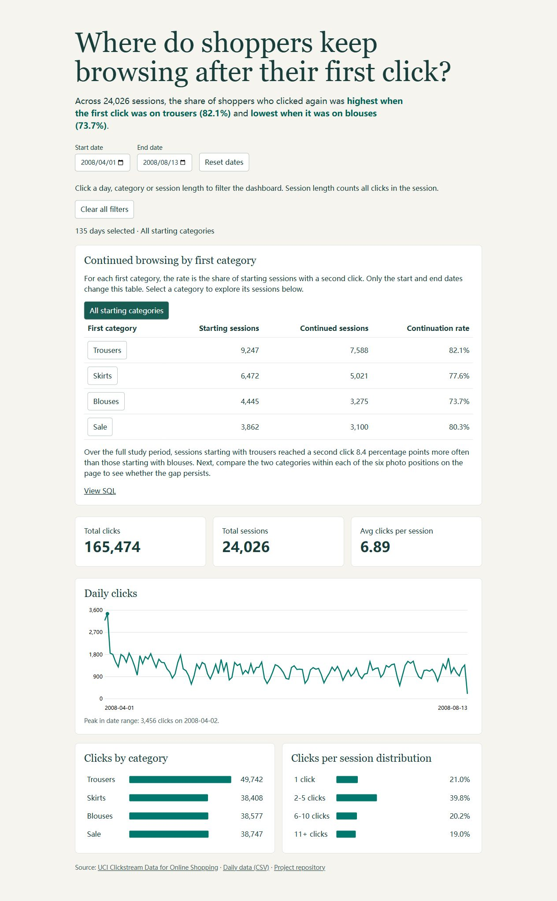

# Online Shopping Clickstream Analysis

[**View the interactive dashboard →**](https://smithchen825.github.io/clickstream-batch-pipeline/)

[**Business report**](BUSINESS_REPORT.md) · [**Pipeline validation record**](reports/pipeline_validation.md) · [**Pipeline notebook**](data/notebooks/04_incremental_clickstream_trial.ipynb)

A portfolio project exploring how visitors browsed an online clothing store, using **Python, PySpark, Databricks and Delta Lake**.

**165,474 clicks · 24,026 sessions · 135 days** | UCI Clickstream Data for Online Shopping, April–August 2008

*Full-period preview (April 1–August 13, 2008). Click the image to explore dates, categories and session lengths in the live dashboard. The business report explains the findings and recommendations; the validation record documents the pipeline checks and observed runs.*

## 🔎 Overview

The project turns click-level records into session and daily summaries, then examines browsing depth, product-category activity and repeat product views. The analysis starts with local pandas checks and continues in Databricks with incremental CSV ingestion, Delta tables and a scheduled Job. The pipeline has processed all 135 daily files and reconciled 165,474 clicks across 24,026 sessions.

## 💼 Business Questions

- How many clicks do visitors make in a session, and how widely do they browse across products?
- Which product categories receive the most browsing activity?
- How does daily traffic vary, and do click volume and session volume move together?
- How often does the same product appear more than once within a session?

The dataset records browsing events. It does not include purchases, orders or conversion outcomes, so the project does not estimate sales or purchase conversion.

## 🧰 Solution

### ⚙️ Data pipeline

1. **Prepare daily batches:** pandas checks the source data and splits it into 135 daily CSV files, each read back and compared with its source records. The files are uploaded to a Unity Catalog volume.
2. **Ingest into Bronze:** Auto Loader discovers new CSVs and appends them to Delta using `availableNow`. A persistent checkpoint tracks ingestion progress. Each run reconciles Bronze against the retained source files by file count, row count and business records.
3. **Validate and rebuild Silver:** Spark standardizes product codes, derives the event date, checks missing values, category codes and duplicate click keys, then rebuilds the cleaned Delta table from accumulated Bronze data.
4. **Build Gold summaries:** session, daily and daily entry-category tables support browsing-depth and continuation-rate analysis. Totals reconcile with Silver, and saved records are compared with the calculated results.
5. **Schedule processing:** a Databricks Job runs the notebook daily on serverless compute. A scheduler-triggered run succeeded; adding a third day and rerunning without new files also passed validation. The final load processed all 135 files successfully.
6. **Publish the dashboard:** GitHub Pages serves the committed aggregate data and interactive charts. Exporting updated dashboard data and committing it to GitHub is a separate step; the Databricks Job does not refresh the public site.

The scheduled pipeline writes these Delta tables in `workspace.default`:

| Table | Grain / role |
| --- | --- |
| `clickstream_bronze_trial` | original click fields plus source-file and ingestion metadata; incremental append |
| `clickstream_silver_trial` | validated click-level records; rebuilt each run |
| `clickstream_sessions_trial` | one row per session |
| `clickstream_daily_trial` | one row per date |
| `clickstream_entry_daily_trial` | one row per date and first category |

The `_trial` names and `two_day_trial` input path were retained from the pilot; they now hold the full dataset. Notebook 03's original analysis tables remain separate.

**Verified full load:** 135 files → 165,474 clicks → 24,026 sessions; zero rescued rows or duplicate click keys. [View the pipeline notebook](data/notebooks/04_incremental_clickstream_trial.ipynb) · [View the validation record](reports/pipeline_validation.md).

These batches come from a static historical dataset, uploaded manually. The Job automates processing after files arrive; it does not collect new live events or automate the upload itself.

## 📌 Key Findings

- Sessions starting in Trousers had the highest second-click rate (**82.1%**), while those starting in Blouses had the lowest (**73.7%**), a gap of **8.4 percentage points**. A second click in any category counts.
- The dataset contains **165,474 clicks** across **24,026 sessions** and **135 dates**, from **2008-04-01 to 2008-08-13**.
- Sessions have a median of **4 clicks** and an average of about **6.89 clicks**. The longest observed session has **195 clicks**.
- **Trousers** received the most clicks (**49,742**). The average listed price per click was highest for Skirts ($51.19) and lowest for Sale ($36.23).
- Daily clicks and daily sessions have a strong positive correlation (**r = 0.949**) across the observed dates.
- **6,046 sessions** included at least one repeat product view. This means a product code appeared more than once in a session; it does not explain why the visitor returned to it.

## 📊 Dashboard

The [business report](BUSINESS_REPORT.md) explains what the browsing patterns support, why the Blouses entry experience merits investigation, and what to check before proposing a change.

The [dashboard is live on GitHub Pages](https://smithchen825.github.io/clickstream-batch-pipeline/). Choose a date range to compare second-click rates by starting category. Select a starting category to explore which categories those sessions browsed and how many clicks they recorded. [View the SQL behind the rates](sql/daily_entry_categories.sql).

## 🧪 Data Quality and Limitations

The inspected data has no missing values in the checked fields, no duplicate `(session_id, click_order)` pairs, and no invalid values in the documented category codes. Click totals and session totals reconcile across the source data, daily summaries and Databricks tables.

The data has no purchase outcomes or within-day timestamps. It cannot support conversion rates, revenue, visit duration or user-level repeat-visit analysis. Session IDs identify sessions, not people across visits. High daily clicks per session on dates with few sessions should be interpreted cautiously.

## 🗂️ Project Files

Read notebook 01 for the pandas checks and daily batch exports, then notebook 02 for the local Spark batch-reading exercise. Run both from `data/notebooks/` in the local environment.

Notebook 03 runs in Databricks with the source CSV uploaded to the `workspace.default.clickstream_data` volume. It reads the full source file and creates the Delta tables used for analysis. Run its cells in order. Notebook 04 adds the scheduled incremental pipeline and preserves separate `_trial` tables. The SQL in `sql/daily_entry_categories.sql` uses the resulting `workspace.default.clickstream_silver` table.

| File | Purpose |
| --- | --- |
| `BUSINESS_REPORT.md` | core findings, business recommendations, metric definitions and limitations |
| `data/notebooks/01_inspect_clickstream.ipynb` | pandas data inspection, reference summaries and daily batch checks |
| `data/notebooks/02_spark_single_batch.ipynb` | local PySpark setup and single-batch read |
| `data/notebooks/03_databricks_clickstream_pipeline.ipynb` | Databricks Spark processing, Delta tables and browsing analysis |
| `data/notebooks/04_incremental_clickstream_trial.ipynb` | Auto Loader ingestion, Bronze/Silver/Gold processing and dynamic reconciliation; run by a scheduled Job |
| `reports/pipeline_validation.md` | observed scheduled-run, incremental-load, rerun and 135-day validation results |
| `sql/daily_entry_categories.sql` | daily summaries by first category, including the counts used for continuation rates |
| `docs/index.html` | published dashboard and browser-side filtering |
| `docs/data/` | aggregate CSVs used by the dashboard |
| `docs/continuation-sql.html` | SQL explanation available from the dashboard |
| `environment.yml` | local Python environment |
| `.gitignore` | excludes raw data and generated batches |

Raw source files and generated daily batches are excluded from Git. The aggregate CSVs in docs/data/ are committed so the public dashboard can load them.

## 📚 Data Source and Attribution

*Clickstream Data for Online Shopping* (2019). UCI Machine Learning Repository. [Dataset page](https://archive.ics.uci.edu/dataset/553/clickstream+data+for+online+shopping) · [DOI: 10.24432/C5QK7X](https://doi.org/10.24432/C5QK7X). Licensed under [CC BY 4.0](https://creativecommons.org/licenses/by/4.0/).

The accompanying data description also requests citation of: Łapczyński, M. and Białowąs, S. (2013). “Discovering Patterns of Users' Behaviour in an E-shop - Comparison of Consumer Buying Behaviours in Poland and Other European Countries.” *Studia Ekonomiczne*, no. 151, pp. 144–153.
